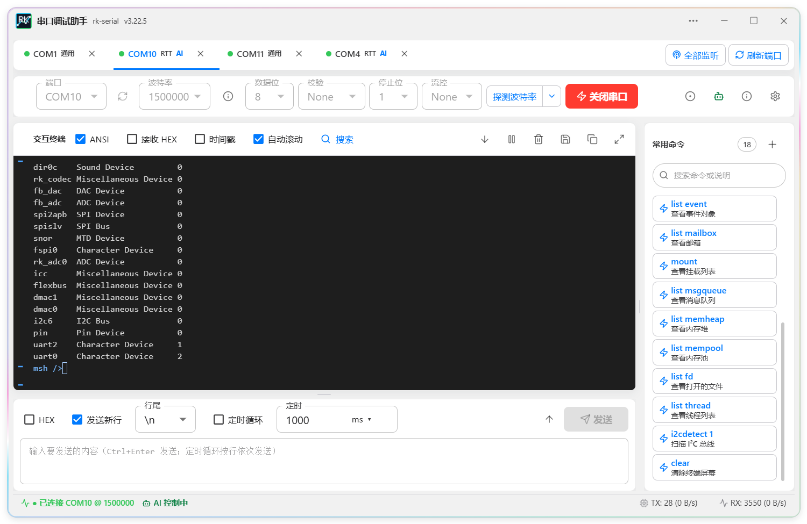
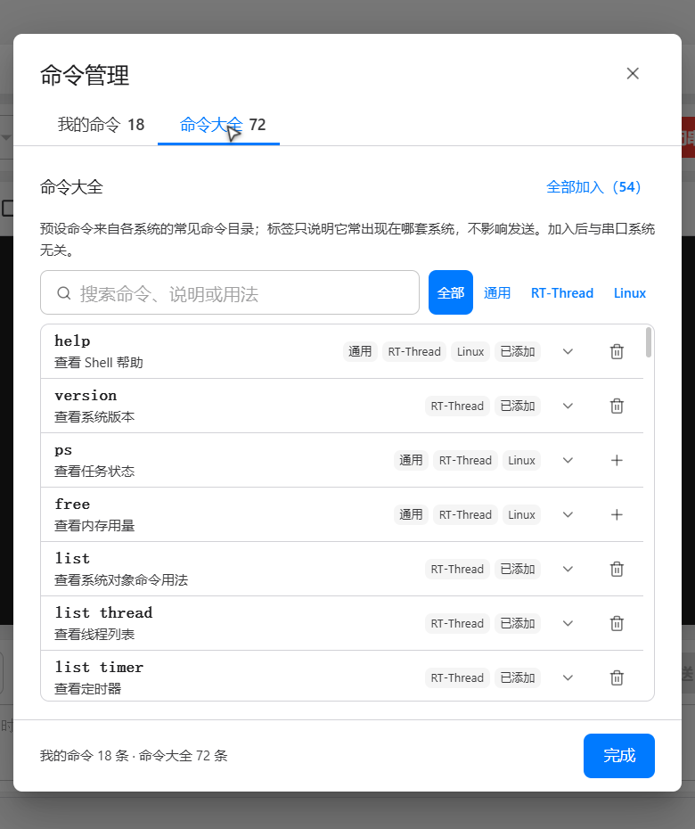
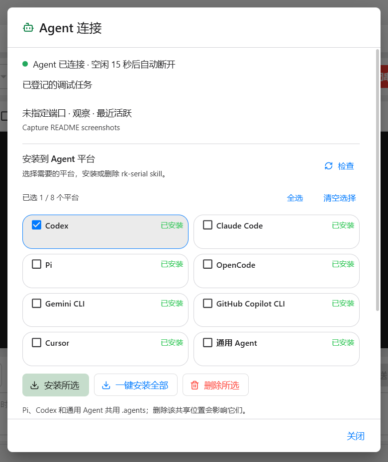
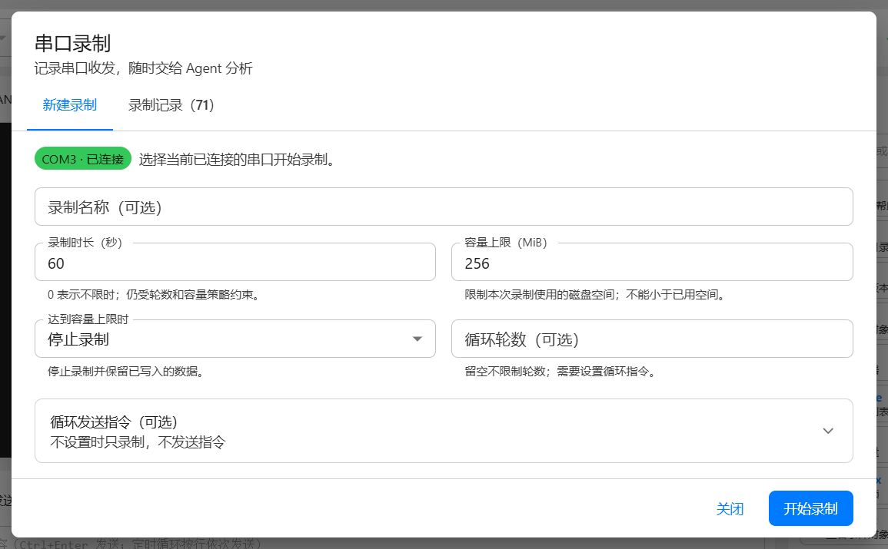

  

<h1 align="center">rk-serial</h1>

Desktop serial debugging for engineers and AI agents

  <a href="#download-and-install">Download</a> ·
  <a href="README.md">简体中文</a>

## What rk-serial solves

rk-serial grew out of board bring-up and debugging at Rockchip. It gives engineers and AI agents a shared desktop workspace for serial debugging.

- **Commands from multiple agents can interleave on one port.** Agents can read the same log concurrently with independent cursors. Control requests queue per port, so only one participant controls a port at a time. An agent can also hold control across a sequence of operations.
- **An engineer and an agent can compete for the same port.** The GUI owns the serial connection and reports when an agent is holding control. An engineer can resume sending once control is released. Each port is coordinated independently.
- **Agent activity can be difficult to observe.** Engineers can follow traffic and logs in the shared terminal during an agent task. The Agent Connection panel shows registered tasks, who holds control, and which requests are waiting.

## Download and install

The links below download **v3.22.5** directly. On Ubuntu, we recommend the `.deb` package for your architecture. Run `dpkg --print-architecture` to check which package you need.

| Platform | Recommended download | Other formats |
| --- | --- | --- |
| Windows 10 / 11 (x64) | [EXE installer][windows-exe] | [MSI installer][windows-msi] · [Portable ZIP][windows-zip] |
| Ubuntu 22.04 / 24.04 / 26.04 LTS (amd64 / x86_64) | [amd64 Debian package][ubuntu-amd64-deb] | [amd64 AppImage][ubuntu-amd64-appimage] |
| Ubuntu 22.04 / 24.04 / 26.04 LTS (arm64 / aarch64) | [arm64 Debian package][ubuntu-arm64-deb] | [arm64 AppImage][ubuntu-arm64-appimage] |

- **Windows.** Run the EXE installer and follow the prompts. The installer can set up WebView2. For the portable ZIP, extract the archive and run `rk-serial-desktop.exe` with `rk-serial-bridge.exe` in the same directory.
- **Ubuntu.** Install the package with `sudo apt install ./<filename>.deb`. To use an AppImage, make it executable and run it. If FUSE is unavailable, pass `--appimage-extract-and-run`.

Check for updates from the About dialog. The app tries a verified delta update when a matching previous package is available and falls back to the full package when needed. [All releases](https://github.com/LiWeny16/rk-serial-releases/releases)

## Debugging features

| Workflow | What you can do |
| --- | --- |
| **Move between Linux and RT-Thread (RTT)** | Detect or set the system type per port. Browse the Linux, RT-Thread, and general command catalog, then add and reorder shortcuts in a shared list. |
| **Send commands and repeat tests** | Get suggestions from send history and use quick commands, timed loops, HEX, or configurable line endings. Each port keeps its own draft. |
| **Capture traffic and investigate intermittent issues** | Start a per-port **Serial Record**, set time or capacity limits, and optionally run a command loop. Review, search, and export the recording for later analysis. |
| **Run a complete workflow with an agent** | The bundled Agent bridge supports port configuration, connections, reads and writes, quick commands, recording, archive search and export, batches, and reusable checks. Engineers and agents operate and observe serial ports through the same GUI. |

## Screenshots

| Linux / RT-Thread command catalog | Agent Connection |
| :---: | :---: |
|  |  |

  
   Serial Record

## Connect an agent

Open **Agent Connection** in the GUI, select your platform, and install the bundled **rk-serial skill**. Then give your agent a port and a task, for example, “Use the rk-serial skill to inspect the boot log on COM10.”

Supported platforms include Codex, Claude Code, Pi, OpenCode, Gemini CLI, GitHub Copilot CLI, Cursor, and compatible agents.

## Acknowledgments

rk-serial builds on the skills contributed by **@吴镜**. Thanks to **@周潼** and **@伟鹏** for their suggestions and testing, and to our Rockchip colleagues for sharing their experience and feedback from day-to-day board development and debugging.

This repository hosts public downloads and release notes.

[windows-exe]: https://github.com/LiWeny16/rk-serial-releases/releases/download/v3.22.5/rk-serial_3.22.5_x64-setup.exe
[windows-msi]: https://github.com/LiWeny16/rk-serial-releases/releases/download/v3.22.5/rk-serial_3.22.5_x64_en-US.msi
[windows-zip]: https://github.com/LiWeny16/rk-serial-releases/releases/download/v3.22.5/rk-serial-v3.22.5-portable.zip
[ubuntu-amd64-deb]: https://github.com/LiWeny16/rk-serial-releases/releases/download/v3.22.5/rk-serial_3.22.5_amd64.deb
[ubuntu-arm64-deb]: https://github.com/LiWeny16/rk-serial-releases/releases/download/v3.22.5/rk-serial_3.22.5_arm64.deb
[ubuntu-amd64-appimage]: https://github.com/LiWeny16/rk-serial-releases/releases/download/v3.22.5/rk-serial_3.22.5_amd64.AppImage
[ubuntu-arm64-appimage]: https://github.com/LiWeny16/rk-serial-releases/releases/download/v3.22.5/rk-serial_3.22.5_arm64.AppImage
