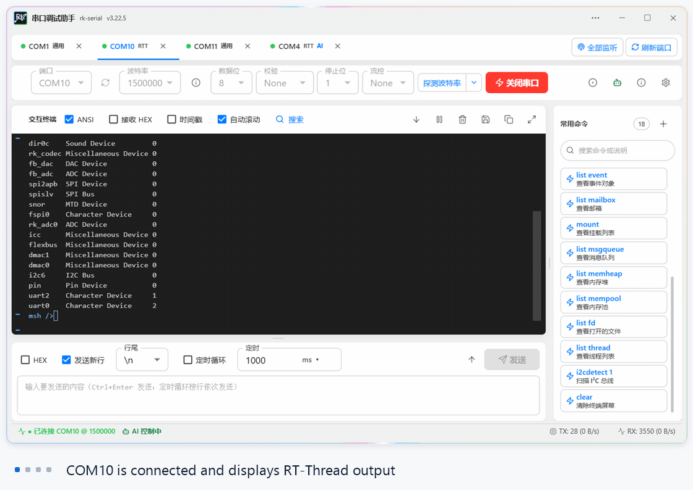
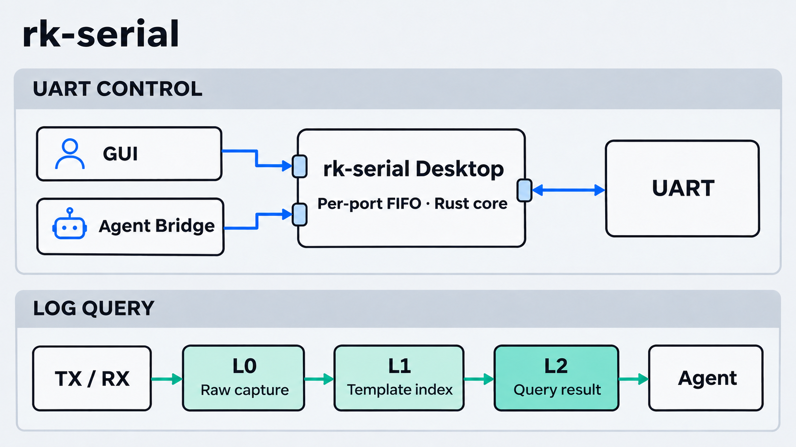

  

<h1 align="center">rk-serial</h1>

<strong>AI-native, cross-platform serial debugging</strong> Windows x64 · Ubuntu LTS amd64 / arm64

  <a href="#download-and-install">Download</a> ·
  <a href="#serial-tool-comparison">Compare tools</a> ·
  <a href="#agent-control-demo">Demo</a> ·
  <a href="#architecture-and-log-layers">Architecture</a> ·
  <a href="README.md">简体中文</a>

## What rk-serial solves

rk-serial grew out of board bring-up and debugging at Rockchip. Agent sessions, port ownership, and log evidence are built into the desktop app. Engineers use the GUI, while agents use the bundled skill and bridge to inspect state, control ports, and run tasks in the same workspace.

### Problem 1: Multiple agents run scripts against the same port

A serial connection needs one owner. Scripts that open the device independently compete for it. Scripts writing directly to a shared connection can interleave commands and replies.

**rk-serial solution**

- The desktop owns the connection. Agents share port state, tasks, and logs.
- Multiple agents can read the same port concurrently, each with its own cursor.
- Each port has its own queue. The current holder can finish a sequence while other agents wait in arrival order.

### Problem 2: An engineer interrupts an agent procedure

A command typed into the terminal can land between two steps of an agent's procedure and make the responses hard to interpret.

**rk-serial solution**

- Human sends and agent control use the same per-port lock. The terminal reports the port as busy while an agent holds it. The engineer can send again once the agent releases it.
- Other ports remain available during the procedure.

### Problem 3: The engineer loses visibility during an agent task

When an agent uses a separate script, the engineer may have to wait for its report to see what it sent, what the board returned, or who is using the port.

**rk-serial solution**

- The terminal keeps showing traffic. The port tab and status bar indicate AI activity.
- Agent Connection shows registered tasks, who controls each port, and who is waiting.

### Problem 4: Repetitive logs fill the agent's context

Passing the full log or repeatedly reading a fixed-size tail uses tokens on duplicate output and makes rare changes hard to spot.

**rk-serial solution**

- **Structured compression.** L1 uses rules to extract templates and parameters and deduplicates exact matches. L0 retains the original traffic.
- **Incremental queries.** L2 returns match counts, changes, and evidence references. Agents use a cursor to read new results and retrieve original lines on demand.
- **95.35% fewer tokens in a hardware test.** The same regex matched 235 build-version lines in an eight-hour RT-Thread serial capture. Sending every match to the agent took **5,640 tokens**. The rk-serial summary and one original line took **262 tokens**. [Benchmark method](#token-comparison)

### Problem 5: Intermittent faults are hard to record and reproduce

Copying terminal output can miss the traffic around a fault. Ad hoc scripts need their own scheduling, recording, and retry logic.

**rk-serial solution**

- Run Serial Record by duration, loop count, or capacity, with optional command loops and evidence export.
- Save repeatable batches or acceptance checks. Request IDs prevent duplicate sends on retry.

### Problem 6: Changing workstations or target systems disrupts the workflow

A team may use different desktop operating systems and switch between Linux and RT-Thread targets. That can mean setting up new tooling or hunting for commands again.

**rk-serial solution**

- Use the same Agent commands and debugging workflow on Windows x64 and Ubuntu LTS amd64 or arm64.
- Add frequently used Linux, RT-Thread, and general commands from the built-in catalog to a shared shortcuts list.

## Serial tool comparison

**✔** means a documented built-in feature. **△** means related operations are available through macros, scripts, or APIs. **✗** means the official documentation reviewed did not identify the feature. The comparison focuses on serial debugging and agent collaboration.

| Capability | **rk-serial** | PuTTY | Tera Term | CoolTerm |
| --- | --- | --- | --- | --- |
| Windows desktop | ✔ x64 | ✔ | ✔ | ✔ |
| Linux desktop | ✔ Ubuntu LTS, amd64 and arm64 | ✔ Linux | **✗** | ✔ Linux |
| Interactive serial I/O and log capture | ✔ | ✔ | ✔ | ✔ |
| Independent sessions for multiple ports | ✔ Tabs in one window | ✔ Separate windows | ✔ Separate windows | ✔ Separate windows |
| HEX view and transmit | ✔ | **✗** | △ HEX debug view, TTL send | ✔ |
| Timed command loops | ✔ In the send panel | △ Plink with a script | △ TTL loops | ✔ Repeating transmit macros |
| Automated serial I/O | ✔ Agent skill and bridge | ✔ Plink CLI | ✔ TTL macros | ✔ Remote control API |
| Linux and RT-Thread command catalog | ✔ Search, filter, and save shortcuts | **✗** | **✗** | **✗** |
| History suggestions and per-port drafts | ✔ | **✗** | **✗** | **✗** |
| Concurrent agent reads with independent cursors | ✔ | **✗** | **✗** | **✗** |
| Per-port agent queue and exclusive multi-step control | ✔ | **✗** | **✗** | **✗** |
| Automatic coordination of human sends and agent control | ✔ | **✗** | △ Macros can disable keyboard input | **✗** |
| Agent task, holder, and queue visible in GUI | ✔ | **✗** | **✗** | **✗** |
| Recording governed by time, loop count, or capacity | ✔ Serial Record | **✗** | △ Macros can rotate logs | △ Capture can be controlled through the API |
| L0 evidence, L1 compressed index, and L2 queries | ✔ Summaries, changes, and evidence expansion | **✗** | **✗** | **✗** |
| Budgeted log queries and evidence references | ✔ Incremental results, pagination, and gap reporting | **✗** | **✗** | **✗** |
| Saved checks and request IDs to prevent duplicate sends | ✔ | **✗** | **✗** | **✗** |
| Explicit handoff of a port to an external flashing tool | ✔ | **✗** | **✗** | **✗** |

Sources include the [PuTTY serial and logging manual](https://the.earth.li/~sgtatham/putty/0.85/htmldoc/Chapter3.html), the [Plink manual](https://the.earth.li/~sgtatham/putty/0.85/htmldoc/Chapter7.html), the [Ubuntu PuTTY package](https://packages.ubuntu.com/noble/putty), the [Tera Term 5 manual](https://teratermproject.github.io/manual/5/en/), the [Tera Term TTL command reference](https://teratermproject.github.io/manual/5/en/macro/command/index.html), and the [CoolTerm official help](https://www.coolterm.net/CoolTermHelp/).

## Agent control demo

COM10 stays connected and displays real RT-Thread output. The capture shows the agent claiming control, reading the log, and releasing control.

## Download and install

The links below download **v3.22.6** directly. On Ubuntu, we recommend the `.deb` package for your architecture. Run `dpkg --print-architecture` to check which package you need.

| Platform | Download |
| --- | --- |
| Windows 10 / 11 (x64) | [Recommended installer (EXE)][windows-exe] · [Managed deployment (MSI)][windows-msi] |
| Ubuntu 22.04 / 24.04 / 26.04 LTS (amd64 / x86_64) | [amd64 Debian package][ubuntu-amd64-deb] |
| Ubuntu 22.04 / 24.04 / 26.04 LTS (arm64 / aarch64) | [arm64 Debian package][ubuntu-arm64-deb] |

- **Windows.** Run the EXE installer and follow the prompts. The installer can set up WebView2. Use the MSI package for managed deployments.
- **Ubuntu.** Install the package with `sudo apt install ./<filename>.deb`. If the app reports a serial permission error, use its permission dialog to add the current user to `dialout`, then sign out and back in.

Check for updates from the About dialog. The app tries a verified delta update when a matching previous package is available and falls back to the full package when needed. [All releases](https://github.com/LiWeny16/rk-serial-releases/releases)

## Architecture and log layers

Engineers use the GUI and agents use the bridge to work through the same desktop app. The serial core handles I/O, while the app coordinates access per port. The terminal continues to show traffic as agents query the log layers.

| Layer | What it stores or returns |
| --- | --- |
| **L0 · Original traffic** | Keeps raw bytes, decoded text, direction, and timestamps per port. Evidence references identify text or bytes to retrieve. |
| **L1 · Rebuildable compressed index** | Groups repeated structures by template and keeps parameter values, counts, and L0 locations. Completed Record segments can persist a compressed index. Queries can scan L0 when an index is unavailable. |
| **L2 · Agent queries and evidence** | `log-query` returns match counts, groups or changes, and evidence references within a byte budget. Responses report completeness and pagination. `log-expand` retrieves the requested L0 evidence. |

### Token comparison

The table compares passing log text directly to an agent with the responses from rk-serial for the same sample. Both sides were counted using `cl100k_base`.

| Measured task | Send log text to the agent | rk-serial responses | Fewer tokens |
| --- | ---: | ---: | ---: |
| **Find build-version lines in an eight-hour RT-Thread hardware capture** (v3.22.5) | All 235 regex matches · **5,640** | L2 summary and one original L0 line · **262** | **95.35%** |
| **Find one rare change among 100,001 error lines** (v3.22.5) | All matching lines · **1,000,010** | Query and evidence expansion · **367** | **99.96%** |
| **Search about 50 MiB of archived logs** (v3.13 benchmark) | Entire log · **13,516,805** | 29 compact query pages · **6,665** | **99.95%** |

The hardware capture contained 1,411 lines. Both methods used `\b[0-9]+\.[0-9]+\.[0-9]+\s+build\b` and found the same 235 lines. The regex baseline counted all matching lines as plain text. rk-serial counted both complete responses: 186 tokens for the L2 query backed by the L1 index and 76 for the L0 evidence expansion.

The last two benchmarks used synthetic samples. The 100,001-line case used an L0 scan to find the rare error code and retrieved its original bytes using the evidence reference. Actual token usage depends on the log, query, and tokenizer.

## Feature highlights

| Workflow | What you can do |
| --- | --- |
| **Deploy across platforms** | Use the same desktop workflow and Agent commands on Windows and Ubuntu. Check for updates in the app, which supports verified deltas with a full-package fallback. |
| **Move between Linux and RT-Thread (RTT)** | Detect or set the system type per port. Browse the Linux, RT-Thread, and general command catalog, then add and reorder shortcuts in a shared list. |
| **Watch multiple ports at once** | Each port has its own terminal and connection status. Use ANSI, HEX, timestamps, search, pause, log export, and navigation to previous sends. |
| **Configure and diagnose a serial link** | Probe baud rates and set data bits, parity, stop bits, flow control, and receive encoding. Agents can also set DTR and RTS and send a Break through the bridge. |
| **Send commands and repeat tests** | Get suggestions from send history and use quick commands, timed line-by-line loops, HEX, or configurable line endings. Each port keeps its own draft. |
| **Capture traffic and investigate intermittent issues** | Start a per-port **Serial Record**, set time, loop count, or capacity rules, and optionally send commands in a loop. Review, search, and export recordings. |
| **Trace a fault back to the evidence** | Review session archives, incident snapshots, and raw bytes. Agents can search a range and expand evidence, with gaps reported in the results. |
| **Run a complete workflow with an agent** | The bundled bridge supports port configuration, connections, reads and writes, incremental queries, quick commands, recording, archive search and export, batches, and reusable checks. It can also coordinate an explicit handoff to an external flashing tool. |

## Screenshots

| Linux / RT-Thread command catalog | Agent Connection |
| :---: | :---: |
|  |  |

  
   Serial Record

## Connect an agent

Open **Agent Connection** in the GUI, select your platform, and install the bundled **rk-serial skill**. Then give your agent a port and a task, for example, “Use the rk-serial skill to inspect the boot log on COM10.”

Supported platforms include Codex, Claude Code, Pi, OpenCode, Gemini CLI, GitHub Copilot CLI, Cursor, and compatible agents.

## Acknowledgments

rk-serial builds on the skills contributed by **@吴镜**. Thanks to **@周潼** and **@伟鹏** for their suggestions and testing, and to our Rockchip colleagues for sharing their experience and feedback from day-to-day board development and debugging.

This repository hosts public downloads and release notes.

[windows-exe]: https://github.com/LiWeny16/rk-serial-releases/releases/download/v3.22.6/rk-serial_3.22.6_x64-setup.exe
[windows-msi]: https://github.com/LiWeny16/rk-serial-releases/releases/download/v3.22.6/rk-serial_3.22.6_x64_en-US.msi
[ubuntu-amd64-deb]: https://github.com/LiWeny16/rk-serial-releases/releases/download/v3.22.6/rk-serial_3.22.6_amd64.deb
[ubuntu-arm64-deb]: https://github.com/LiWeny16/rk-serial-releases/releases/download/v3.22.6/rk-serial_3.22.6_arm64.deb
