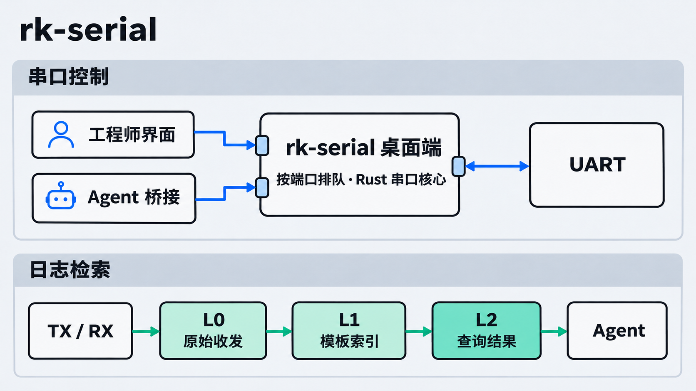
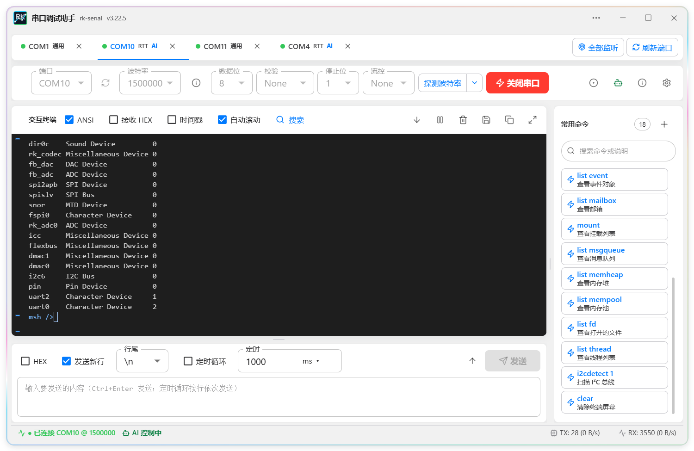
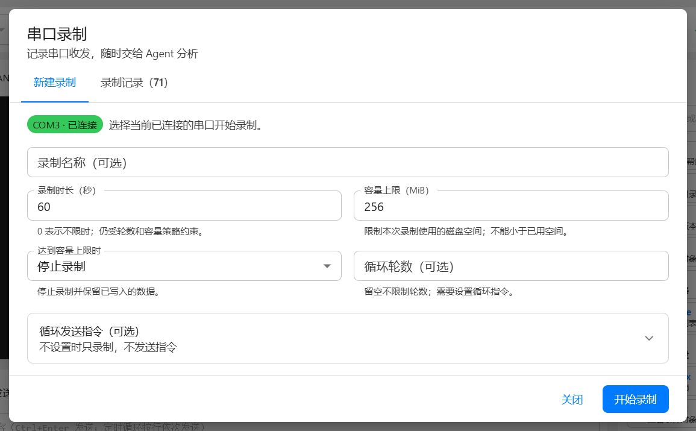

  

<h1 align="center">rk-serial · 串口调试助手</h1>

<strong>AI Native 跨平台串口调试助手</strong> Windows x64 · Ubuntu LTS amd64 / arm64

  <a href="#下载与安装">下载</a> ·
  <a href="#主流串口工具对比">功能对比</a> ·
  <a href="#agent-控口实拍">控口演示</a> ·
  <a href="#架构与日志分层">架构</a> ·
  <a href="README.en.md">English</a>

## 解决了什么痛点

rk-serial 来自 Rockchip 同事在板卡开发与联调中的实际需求。从设计之初就把 **Agent 会话、串口控制权和日志证据** 纳入桌面工具。工程师通过 GUI 调试，Agent 通过随包提供的 Skill 和桥接工具读取状态、控口和执行任务，双方共用一个可观察的工作台。

### 痛点 1：多个 Agent 用脚本操作同一个串口

串口需要独占管理。多个脚本各自打开端口会争抢连接，共用连接直接写入又容易让命令和回显交叉。

**rk-serial 解决方案**

- 桌面端独占连接，Agent 共享串口状态、任务和日志。
- 多个 Agent 可以同时读取同一串口，各自保留读取位置。
- 每个串口独立排队。当前持有者先完成整段操作，其他 Agent 按到达顺序等待。

### 痛点 2：人工发送打断 Agent 正在执行的流程

工程师在终端输入一条命令，可能插入 Agent 的多步操作，让后续回显和判断对不上。

**rk-serial 解决方案**

- 人工发送和 Agent 共用端口控制权。Agent 控口时，人工发送会收到端口忙提示，释放后即可继续。
- 每个串口独立协调，其他串口可照常使用。

### 痛点 3：Agent 在调试，工程师看不到现场

独立脚本执行时，工程师往往要等 Agent 汇报，无法在同一个终端跟进串口收发，也不知道谁正在使用端口。

**rk-serial 解决方案**

- 实时终端持续显示收发内容，串口标签和状态栏提示 AI 活动。
- 「Agent 连接」显示已登记的任务、控口者和等待状态。

### 痛点 4：几十万行日志挤满上下文

每次把全文或固定长度的尾部交给模型，重复输出占用大量 tokens，偶发变化也容易被淹没。

**rk-serial 解决方案**

- **结构化压缩。** L1 用规则提取日志模板和参数，精确去重。L0 保留原始收发证据。
- **增量查询。** L2 返回命中数、变化和证据引用。Agent 用游标读取新增结果，按需展开原文。
- **实测节省 95.35% tokens。** 在 8 小时 RT-Thread 真板日志中，用同一条正则查找版本回显。直接把 235 条命中行交给 Agent 需要 **5,640 tokens**，rk-serial 的汇总和一条原文证据共 **262 tokens**。[实测口径](#token-对比)

### 痛点 5：偶发故障难留证，验证流程难复跑

手工复制终端容易漏掉故障前后的收发，临时脚本还要自行处理定时、留档和重试。

**rk-serial 解决方案**

- 串口 Record 可按时长、轮数或容量策略运行，支持循环发送和证据导出。
- 将常用流程保存为批处理或验收用例，用请求 ID 防止重试时重复发送。

### 痛点 6：换电脑或切换目标系统，调试习惯得重来

团队成员使用不同系统，板端又可能是 Linux 或 RT-Thread。换电脑时常要重新配置工具，切换板端系统也要重新找命令。

**rk-serial 解决方案**

- Windows x64 和 Ubuntu LTS amd64／arm64 使用同一套 Agent 命令和调试流程。
- 命令大全内置 Linux、RT-Thread 和通用命令，常用项可加入共享快捷列表。

## 主流串口工具对比

**✔** 表示有对应内置功能，**△** 表示宏、脚本或接口可完成部分相关操作，**✗** 表示官方资料中未找到对应功能。比较范围是串口调试与 Agent 协作。

| 能力 | **rk-serial** | PuTTY | Tera Term | CoolTerm |
| --- | --- | --- | --- | --- |
| Windows 桌面 | ✔ x64 | ✔ | ✔ | ✔ |
| Linux 桌面 | ✔ Ubuntu LTS，amd64／arm64 | ✔ Linux | **✗** | ✔ Linux |
| 交互式串口收发与日志保存 | ✔ | ✔ | ✔ | ✔ |
| 多串口独立会话 | ✔ 同一窗口内切换标签 | ✔ 独立窗口 | ✔ 独立窗口 | ✔ 独立窗口 |
| HEX 查看与发送 | ✔ | **✗** | △ HEX 调试显示、TTL 发送 | ✔ |
| 定时循环发送 | ✔ 发送区直接设置 | △ Plink 加外部脚本 | △ TTL 循环 | ✔ 发送宏可设置重复 |
| 自动化串口读写 | ✔ Agent Skill 与桥接 | ✔ Plink 命令行 | ✔ TTL 宏 | ✔ 远程控制接口 |
| Linux／RT-Thread 系统命令大全 | ✔ 搜索、筛选、加入常用 | **✗** | **✗** | **✗** |
| 发送历史联想与每端口独立草稿 | ✔ | **✗** | **✗** | **✗** |
| 多 Agent 并发读、各自保存增量游标 | ✔ | **✗** | **✗** | **✗** |
| 多 Agent 按端口排队控口、整段操作互斥 | ✔ | **✗** | **✗** | **✗** |
| 人工发送与 Agent 控口自动协调 | ✔ | **✗** | △ 宏可禁用键盘输入 | **✗** |
| GUI 显示 Agent 任务、控制者和等待状态 | ✔ | **✗** | **✗** | **✗** |
| 限时、限轮或按容量管理的收发录制 | ✔ 串口 Record | **✗** | △ 宏可轮转日志 | △ 可通过接口控制日志捕获 |
| L0 原始证据、L1 压缩索引、L2 查询 | ✔ 摘要、变化与按需展开 | **✗** | **✗** | **✗** |
| 有预算的日志查询和证据引用 | ✔ 增量、分页、缺口状态 | **✗** | **✗** | **✗** |
| 保存验收用例与请求 ID 防重发 | ✔ | **✗** | **✗** | **✗** |
| 同一串口与外部烧录器显式交接 | ✔ | **✗** | **✗** | **✗** |

对照资料：[PuTTY 串口与日志](https://the.earth.li/~sgtatham/putty/0.85/htmldoc/Chapter3.html)、[Plink 命令](https://the.earth.li/~sgtatham/putty/0.85/htmldoc/Chapter7.html)、[Ubuntu 的 PuTTY 软件包](https://packages.ubuntu.com/noble/putty)、[Tera Term 5 手册](https://teratermproject.github.io/manual/5/en/)、[Tera Term TTL 命令](https://teratermproject.github.io/manual/5/en/macro/command/index.html)、[CoolTerm 官方帮助](https://www.coolterm.net/CoolTermHelp/)。

## Agent 控口实拍

COM10 保持连接，终端显示实际 RT-Thread 输出。动图依次展示 Agent 取得控制权、读取日志以及释放控制权。

## 下载与安装

以下链接可直接下载 **v3.22.6**。Ubuntu 用户推荐安装与系统架构匹配的 `.deb` 包，可运行 `dpkg --print-architecture` 确认架构。

| 系统 | 下载 |
| --- | --- |
| Windows 10 / 11（x64） | [推荐安装包（EXE）][windows-exe] · [批量部署（MSI）][windows-msi] |
| Ubuntu 22.04 / 24.04 / 26.04 LTS（amd64 / x86_64） | [amd64 安装包（DEB）][ubuntu-amd64-deb] |
| Ubuntu 22.04 / 24.04 / 26.04 LTS（arm64 / aarch64） | [arm64 安装包（DEB）][ubuntu-arm64-deb] |

- **Windows**：运行 EXE 安装包，按向导完成安装。安装程序可引导安装 WebView2。需要通过软件分发工具批量部署时，使用 MSI 安装包。
- **Ubuntu**：用 `sudo apt install ./<文件名>.deb` 安装。如果应用提示串口权限不足，可在应用内将当前用户加入 `dialout`，注销并重新登录后生效。

已安装用户可通过「关于 → 检查更新」获取新版。旧安装包匹配时，应用会优先尝试经过校验的差量更新，必要时回退到完整安装包。[查看所有版本](https://github.com/LiWeny16/rk-serial-releases/releases)

## 架构与日志分层

工程师通过 GUI 操作串口，Agent 通过桥接使用同一个桌面端。串口核心负责读写，桌面端按端口协调控制权。终端持续显示收发内容，Agent 可查询分层后的日志。

| 层级 | 保存或返回的内容 |
| --- | --- |
| **L0 · 原始收发记录** | 按端口保留原始字节、解码文本、收发方向与时间。需要查证时可按引用读取对应原文或字节。 |
| **L1 · 可重建的压缩索引** | 将重复的结构归为模板，保留参数、计数和指向 L0 的位置。已完成的 Record 分段可保存压缩索引，索引不可用时可扫描 L0。 |
| **L2 · Agent 查询与证据** | `log-query` 按条件和字节预算返回命中数、分组或变化以及证据引用，并标明完整性和分页状态。`log-expand` 沿引用取回需要的 L0 证据。 |

### Token 对比

对同一个样本，比较 Agent 直接读取日志文本与读取 rk-serial 查询结果的上下文用量。表中均使用 `cl100k_base` 实际分词。

| 实测场景 | 直接把日志交给 Agent | rk-serial 返回 | 减少的 tokens |
| --- | ---: | ---: | ---: |
| **查找 8 小时 RT-Thread 真板日志里的版本回显**（v3.22.5） | 正则命中的 235 行 · **5,640** | L2 汇总和一条 L0 原文 · **262** | **95.35%** |
| **定位 100,001 行错误日志中的一次罕见变化**（v3.22.5） | 所有命中行 · **1,000,010** | 查询与原文展开，共两次响应 · **367** | **99.96%** |
| **检索约 50 MiB 的历史日志**（v3.13 基准） | 整份日志 · **13,516,805** | 29 页精简查询响应 · **6,665** | **99.95%** |

真板样本有 1,411 行。两边用 `\b[0-9]+\.[0-9]+\.[0-9]+\s+build\b` 查找版本行，均命中 235 条相同的记录。正则基线将全部命中行作为纯文本计数。rk-serial 计入基于 L1 索引的 L2 查询和 L0 原文展开的完整响应，分别为 186 和 76 tokens。

后两项使用合成样本。100,001 行用例通过 L0 扫描找到罕见错误码，再按引用核对原文。实测节省随日志重复度、查询范围和分词器而变化。

## 功能亮点

| 场景 | rk-serial 的做法 |
| --- | --- |
| **跨平台部署** | Windows 与 Ubuntu 共用桌面工作流和 Agent 命令。应用内检查更新，支持验证后应用差量更新和回退完整包。 |
| **在 Linux 和 RT-Thread（RTT）之间切换** | 按串口识别系统类型，也支持手动标记。命令大全提供 Linux、RT-Thread 和通用命令，可搜索用法、一键加入共享快捷列表并拖动排序。 |
| **同时观察多个串口** | 多端口标签独立显示连接状态和终端。支持 ANSI、HEX、时间戳、搜索、暂停、日志导出，以及跳转到历史发送位置。 |
| **配置和排查串口** | 支持波特率探测、数据位、校验位、停止位、流控和接收编码设置。Agent 还可通过桥接设置 DTR、RTS 和发送 Break。 |
| **快速发送和重复测试** | 从发送历史联想命令，支持快捷命令、定时分行循环发送、HEX 和可配置行尾。多个串口各自保留发送草稿。 |
| **录制串口和复盘** | 使用 **串口 Record** 按串口录制，可设置时长、轮数和容量策略，也能同时循环发送。录制可在 GUI 查看，支持检索和导出。 |
| **定位故障保留证据** | 通过会话归档、故障现场和原始字节回读追溯现场。Agent 按范围检索与展开证据，查询会报告缺口。 |
| **让 Agent 执行完整调试流程** | 内置桥接覆盖串口配置与连接、读写、增量查询、快捷命令、录制、归档检索和导出、批处理与验收用例。需要外部烧录器接管同一个端口时，可以显式交接。 |

## 界面预览

| Linux / RT-Thread 命令大全 | Agent 连接 |
| :---: | :---: |
|  |  |

  
   串口录制

## 接入 Agent

在 GUI 打开「Agent 连接」，选择平台并安装随软件提供的 **rk-serial skill**。安装完成后，在 Agent 中说明端口和任务，例如「使用 rk-serial skill 查看 COM10 的启动日志」。

可选平台包括 Codex、Claude Code、Pi、OpenCode、Gemini CLI、GitHub Copilot CLI、Cursor 和兼容 Agent。

## 致谢

rk-serial 在 **@吴镜** 提供的 Skills 基础上开发。感谢 **@周潼**、**@伟鹏** 提出改进建议并参与测试，也感谢 Rockchip 同事在日常板卡开发与联调中分享的经验和反馈。

本仓库提供公开下载与版本说明。

[windows-exe]: https://github.com/LiWeny16/rk-serial-releases/releases/download/v3.22.6/rk-serial_3.22.6_x64-setup.exe
[windows-msi]: https://github.com/LiWeny16/rk-serial-releases/releases/download/v3.22.6/rk-serial_3.22.6_x64_en-US.msi
[ubuntu-amd64-deb]: https://github.com/LiWeny16/rk-serial-releases/releases/download/v3.22.6/rk-serial_3.22.6_amd64.deb
[ubuntu-arm64-deb]: https://github.com/LiWeny16/rk-serial-releases/releases/download/v3.22.6/rk-serial_3.22.6_arm64.deb
