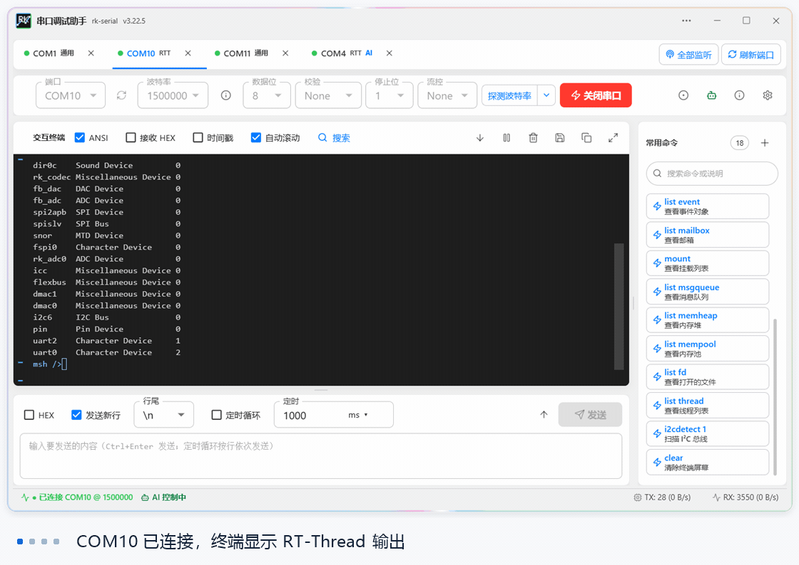
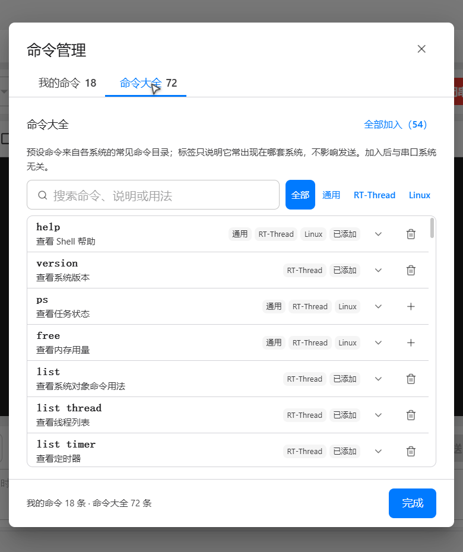
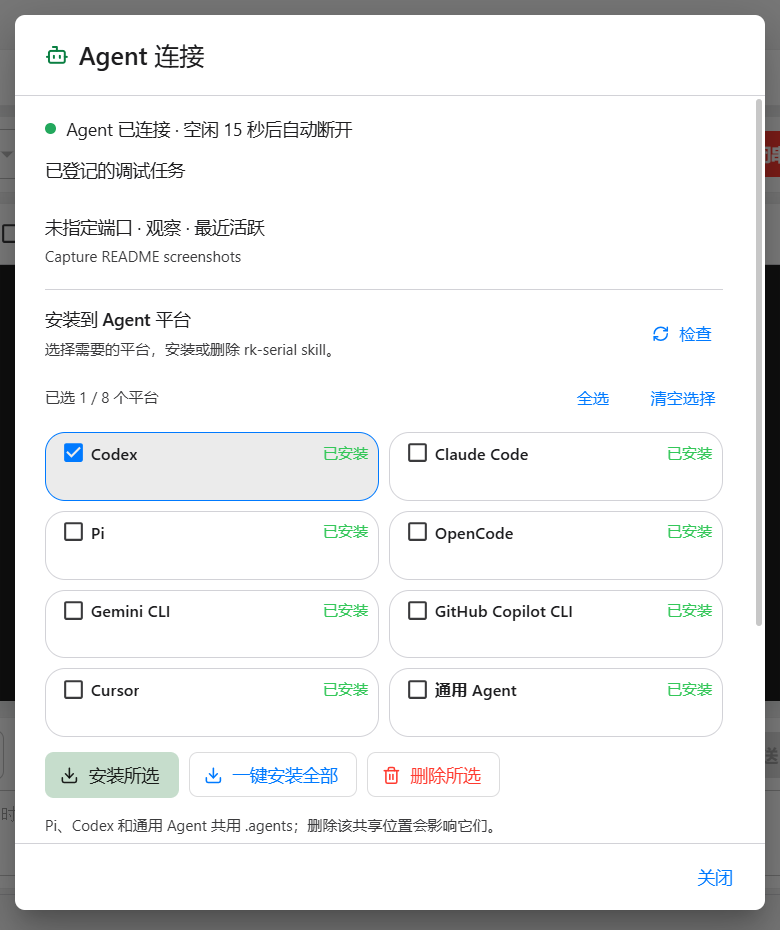

  

<h1 align="center">rk-serial · 串口调试助手</h1>

面向人与 AI Agent 协作的桌面串口调试工具

  <a href="#下载与安装">下载</a> ·
  <a href="#agent-控口实拍">控口演示</a> ·
  <a href="#架构与日志分层">架构</a> ·
  <a href="README.en.md">English</a>

## 解决了什么痛点

rk-serial 来自 Rockchip 同事在板卡开发与联调中的实际需求。工程师和 AI Agent 在同一个桌面工作台使用串口，并能随时核对操作和日志。

| 调试场景 | 常见方案遇到的问题 | rk-serial 如何解决 |
| --- | --- | --- |
| 多个 Agent 共用一个串口 | 各自打开设备会争抢串口，共用脚本写入又容易让命令和回显交叉。 | 多个 Agent 可同时读，各自保留日志游标。写操作按端口先进先出，多步任务可在同一次控口期间完成。 |
| 工程师与 Agent 同时操作 | 工程师在终端输入的命令可能插入 Agent 正在执行的流程。 | 桌面端统一持有串口。Agent 控口时，人工发送会收到端口忙提示，释放后可继续。不同串口独立协调。 |
| 跟进 Agent 的调试过程 | Agent 用独立脚本读写时，工程师通常只能等它转述日志和结果。 | 终端持续显示收发内容，端口标签显示 AI 状态；「Agent 连接」可查看已登记任务、持有者及排队状态。 |
| 在大段日志里找一次异常 | 整段日志或反复读取的尾部会堆满上下文，稀有变化容易埋在重复输出里。 | L0 保留原始证据，L1 按模板和参数建立索引，L2 按条件返回计数、变化和证据引用，需核对时再展开原文。 |
| 录下偶发问题或复跑同一验证 | 手工复制终端易丢上下文，临时脚本还要自行处理保存、轮询和重试。 | 串口 Record 可按时长、轮数或容量运行并导出证据；批处理和验收用例支持复用，借助请求 ID 避免误重发。 |

## Agent 控口实拍

COM10 保持连接，终端显示实际 RT-Thread 输出。动图依次展示 Agent 取得控制权、读取日志以及释放控制权。

## 下载与安装

以下链接可直接下载 **v3.22.5**。Ubuntu 用户推荐安装与系统架构匹配的 `.deb` 包，可运行 `dpkg --print-architecture` 确认架构。

| 系统 | 推荐下载 | 其他格式 |
| --- | --- | --- |
| Windows 10 / 11（x64） | [安装包（EXE）][windows-exe] | [MSI 安装包][windows-msi] · [绿色版（ZIP）][windows-zip] |
| Ubuntu 22.04 / 24.04 / 26.04 LTS（amd64 / x86_64） | [amd64 安装包（DEB）][ubuntu-amd64-deb] | [amd64 便携版（AppImage）][ubuntu-amd64-appimage] |
| Ubuntu 22.04 / 24.04 / 26.04 LTS（arm64 / aarch64） | [arm64 安装包（DEB）][ubuntu-arm64-deb] | [arm64 便携版（AppImage）][ubuntu-arm64-appimage] |

- **Windows**：运行 EXE 安装包，按向导完成安装，安装程序可引导安装 WebView2。使用绿色版时，解压后运行 `rk-serial-desktop.exe`，并将 `rk-serial-bridge.exe` 保留在同一目录。
- **Ubuntu**：用 `sudo apt install ./<文件名>.deb` 安装。使用 AppImage 时，赋予文件执行权限后运行。没有 FUSE 时，可加上 `--appimage-extract-and-run`。

已安装用户可通过「关于 → 检查更新」获取新版。旧安装包匹配时，应用会优先尝试经过校验的差量更新，必要时回退到完整安装包。[查看所有版本](https://github.com/LiWeny16/rk-serial-releases/releases)

## 架构与日志分层

工程师通过 GUI 操作串口，Agent 通过桥接使用同一个桌面端。串口核心负责读写，桌面端按端口协调控制权。终端持续显示收发内容，Agent 可查询分层后的日志。

| 层级 | 保存或返回的内容 |
| --- | --- |
| **L0 · 原始收发记录** | 按端口保留原始字节、解码文本、收发方向与时间。需要查证时可按引用读取对应原文或字节。 |
| **L1 · 可重建的压缩索引** | 将重复的结构归为模板，保留参数、计数和指向 L0 的位置。已完成的 Record 分段可保存压缩索引，索引不可用时可扫描 L0。 |
| **L2 · Agent 查询与证据** | `log-query` 按条件和字节预算返回命中数、分组或变化以及证据引用，并标明完整性和分页状态。`log-expand` 沿引用取回需要的 L0 证据。 |

### Token 对比

对同一个样本，比较普通 Agent 流程中直接读取文本的成本，与 rk-serial 检索后返回的内容。表中均使用 `cl100k_base` 实际分词。

| 实测场景 | 直接把日志交给 Agent | rk-serial 返回 | 减少的 tokens |
| --- | ---: | ---: | ---: |
| **定位 100,001 行错误日志中的一次罕见变化**（v3.22.5） | 所有命中行 · **1,000,010** | 查询与原文展开，共两次响应 · **367** | **99.96%** |
| **检索约 50 MiB 的历史日志**（v3.13 基准） | 整份日志 · **13,516,805** | 29 页精简查询响应 · **6,665** | **99.95%** |

两个场景均为合成样本。第一项有 100,000 条相同错误和 1 条不同错误码，查询只按 `ERROR` 匹配并从结果展开该条原始证据。此次通过 L0 扫描回退完成，节省来自按问题取证；实际用量随日志重复度、查询范围和模型分词器而变化。

## 日常调试能力

| 场景 | rk-serial 的做法 |
| --- | --- |
| **在 Linux 和 RT-Thread（RTT）之间切换** | 按串口识别系统类型，也支持手动标记。命令大全提供 Linux、RT-Thread 和通用命令，可搜索用法、一键加入共享快捷列表并拖动排序。 |
| **同时观察多个串口** | 多端口标签独立显示连接状态和终端。支持 ANSI、HEX、时间戳、搜索、暂停、日志导出和波特率探测。 |
| **快速发送和重复测试** | 从发送历史联想命令，支持快捷命令、定时分行循环发送、HEX 和可配置行尾。多个串口各自保留发送草稿。 |
| **录制串口和复盘** | 使用 **串口 Record** 按串口录制，可设置时长、轮数和容量策略，也能同时循环发送。录制可在 GUI 查看，支持检索和导出。 |
| **让 Agent 执行完整调试流程** | 内置桥接覆盖串口配置与连接、读写、增量查询、快捷命令、录制、归档检索和导出、批处理与验收用例。需要外部烧录器接管同一个端口时，可以显式交接。 |

## 界面预览

| Linux / RT-Thread 命令大全 | Agent 连接 |
| :---: | :---: |
|  |  |

  
   串口录制

## 接入 Agent

在 GUI 打开「Agent 连接」，选择平台并安装随软件提供的 **rk-serial skill**。安装完成后，在 Agent 中说明端口和任务，例如「使用 rk-serial skill 查看 COM10 的启动日志」。

可选平台包括 Codex、Claude Code、Pi、OpenCode、Gemini CLI、GitHub Copilot CLI、Cursor 和兼容 Agent。

## 致谢

rk-serial 在 **@吴镜** 提供的 Skills 基础上开发。感谢 **@周潼**、**@伟鹏** 提出改进建议并参与测试，也感谢 Rockchip 同事在日常板卡开发与联调中分享的经验和反馈。

本仓库提供公开下载与版本说明。

[windows-exe]: https://github.com/LiWeny16/rk-serial-releases/releases/download/v3.22.5/rk-serial_3.22.5_x64-setup.exe
[windows-msi]: https://github.com/LiWeny16/rk-serial-releases/releases/download/v3.22.5/rk-serial_3.22.5_x64_en-US.msi
[windows-zip]: https://github.com/LiWeny16/rk-serial-releases/releases/download/v3.22.5/rk-serial-v3.22.5-portable.zip
[ubuntu-amd64-deb]: https://github.com/LiWeny16/rk-serial-releases/releases/download/v3.22.5/rk-serial_3.22.5_amd64.deb
[ubuntu-arm64-deb]: https://github.com/LiWeny16/rk-serial-releases/releases/download/v3.22.5/rk-serial_3.22.5_arm64.deb
[ubuntu-amd64-appimage]: https://github.com/LiWeny16/rk-serial-releases/releases/download/v3.22.5/rk-serial_3.22.5_amd64.AppImage
[ubuntu-arm64-appimage]: https://github.com/LiWeny16/rk-serial-releases/releases/download/v3.22.5/rk-serial_3.22.5_arm64.AppImage
